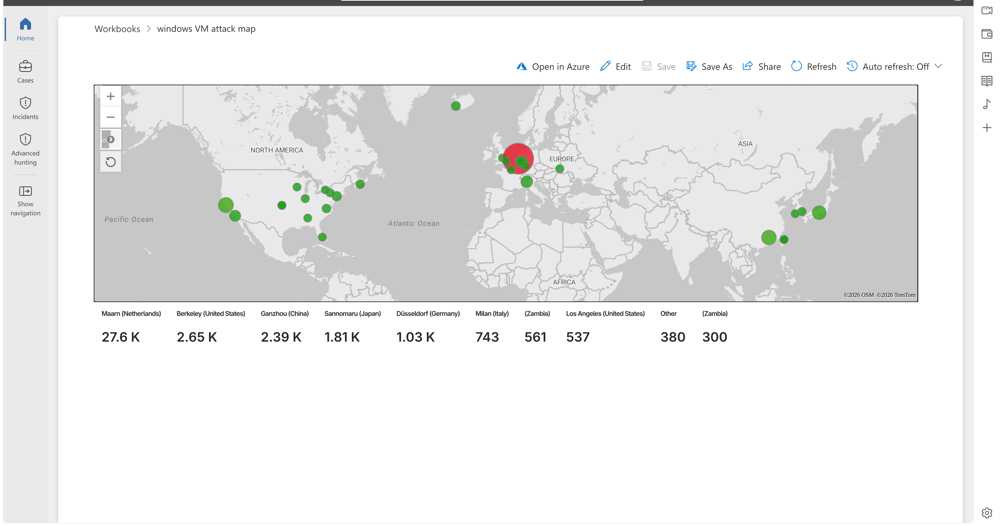
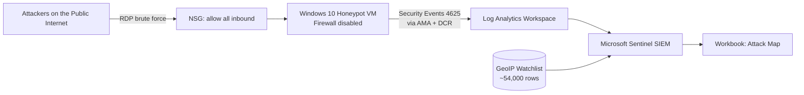
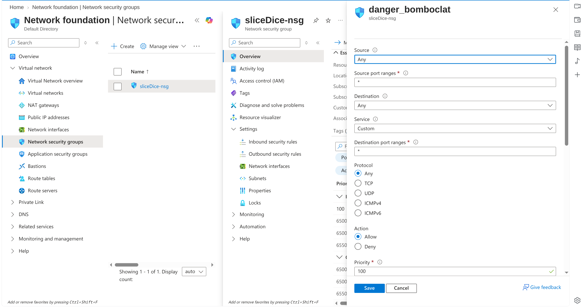
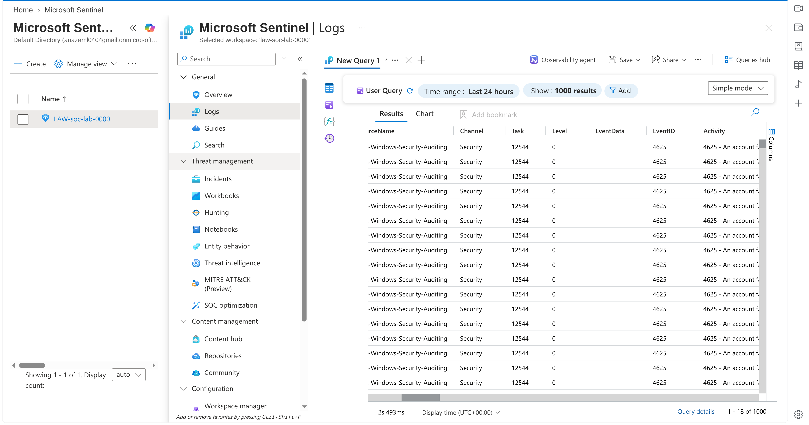
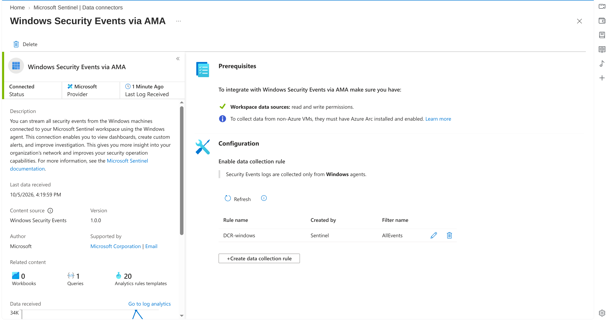
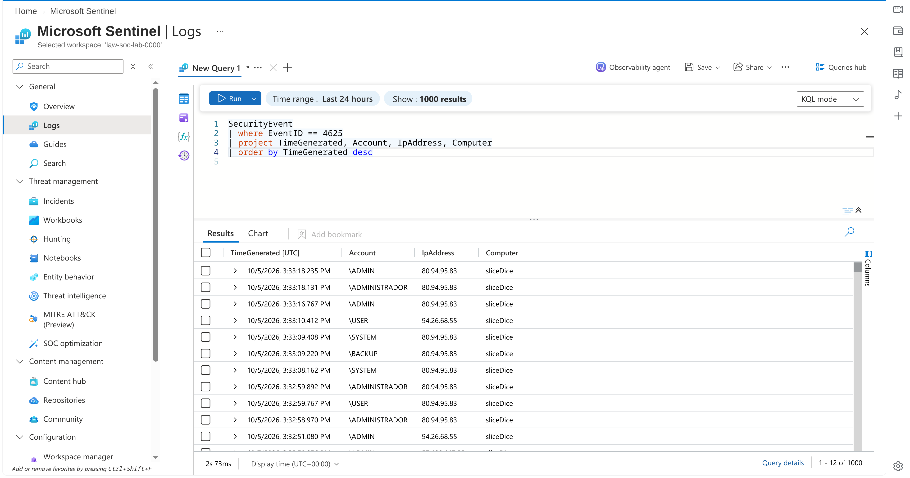
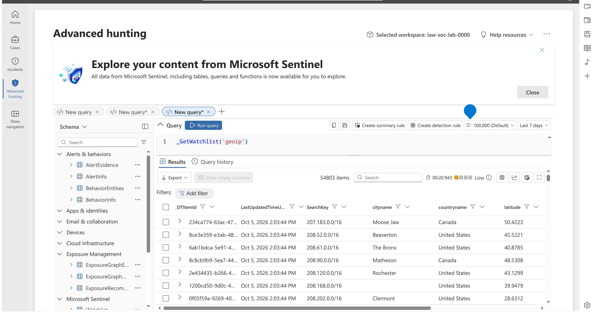
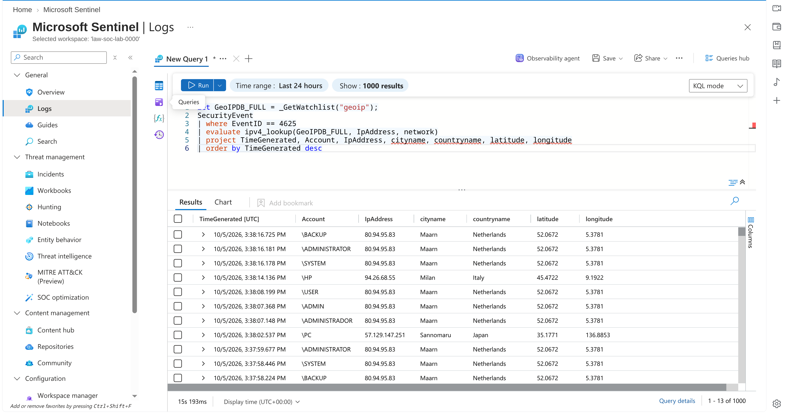

# Azure Sentinel Honeypot & Live Attack Map

A hands-on SOC lab: I deployed an intentionally exposed Windows VM in Azure, collected
real attack logs in Microsoft Sentinel, enriched them with geolocation data, and built a
live world map of attacker locations.

> This project follows the lab by Josh Madakor ("Cyber Home Lab" / Cyber Range).
> All setup, screenshots, queries and analysis in this repo are from my own deployment.



## Objective
Learn how a SOC collects, queries and visualizes security logs: from an exposed endpoint,
through a log pipeline, into a SIEM, to a dashboard.

## Architecture



Everything lives inside a single Azure Subscription and Resource Group (VM + VNet,
Log Analytics Workspace, Microsoft Sentinel).

## Tools & Technologies
Microsoft Azure · Microsoft Sentinel · Log Analytics Workspace · Azure Monitor Agent (AMA) ·
Data Collection Rules (DCR) · Network Security Groups · KQL · Windows Event Viewer ·
Sentinel Watchlists · Sentinel Workbooks

## Walkthrough

### 1. Azure setup
Created an Azure subscription and a resource group.

### 2. Honeypot VM
- Deployed a Windows 10 VM
- Edited the NSG to allow all inbound traffic
- Disabled Windows Defender Firewall (`wf.msc` > Properties > all profiles off)




### 3. Inspecting logs locally
Failed 3 logins as a fake user, then confirmed **Event ID 4625** in Event Viewer > Security.



### 4. Log forwarding with AMA and DCR
- Created a Log Analytics Workspace
- Enabled Microsoft Sentinel on the workspace
- Configured the **Windows Security Events via AMA** connector
- Created a Data Collection Rule and verified the agent extension installed on the VM



### 5. Querying with KQL
```kql
SecurityEvent
| where EventID == 4625
```


### 6. Log enrichment with GeoIP
Raw logs only contain an IP address. I imported a GeoIP CSV (~54,000 rows) as a Sentinel
**watchlist** (alias `geoip`, search key `network`) and joined it using `ipv4_lookup`.

```kql
let GeoIPDB_FULL = _GetWatchlist("geoip");
SecurityEvent
| where EventID == 4625
| evaluate ipv4_lookup(GeoIPDB_FULL, IpAddress, network)
```



### 7. Attack map
Created a Sentinel Workbook, replaced the default content with a query element, pasted the
map JSON in the Advanced Editor, and plotted attacks by latitude/longitude, sized by
number of attempts.


## Results
<!-- Replace with YOUR real numbers after the VM has run for 24 to 48 hours -->
- Total failed logins: **X** in **Y hours**
- Unique attacker IPs: **X** from **Y** countries
- Top source countries: 1. ___ 2. ___ 3. ___
- Most targeted usernames: ___, ___, ___

## Key Takeaways
- An internet-exposed RDP host is attacked within minutes
- Attackers brute force common usernames such as `administrator`, `admin`, `user`
- Raw logs lack context; enrichment (GeoIP) makes them actionable
- KQL is a core SOC skill for hunting and investigation

## Security Notes
This VM was deliberately insecure and used only for the lab. In production you would:
restrict RDP with NSG rules or Azure Bastion/JIT access, enable MFA, keep the host
firewall on, and alert on repeated 4625 events.

## Cleanup
All resources (resource group, VM, workspace) were deleted after the lab to avoid charges.

## Repo Contents
| Path | Description |
|---|---|
| `queries/` | KQL queries used in the lab |
| `workbook/map.json` | Sentinel Workbook JSON for the attack map |
| `screenshots/` | Evidence from my deployment |
| `docs/architecture.md` | Architecture and component breakdown |

## Credits
Lab by [Josh Madakor](https://www.youtube.com/@JoshMadakor) / [Cyber Range](https://skool.com/cyber-range).
GeoIP data: [geoip-summarized.csv](https://raw.githubusercontent.com/joshmadakor1/lognpacific-public/refs/heads/main/misc/geoip-summarized.csv)
