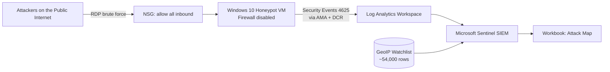

# Architecture

## Components
| Component | Role |
|---|---|
| Azure Subscription / Resource Group | Container for all lab resources |
| Windows 10 VM | Honeypot, intentionally exposed |
| NSG | Cloud firewall, rule set to allow all inbound |
| Azure Monitor Agent (AMA) + DCR | Collects Windows Security Events and forwards them |
| Log Analytics Workspace (LAW) | Central log repository, queried with KQL |
| Microsoft Sentinel | SIEM on top of the LAW |
| Watchlist (geoip) | IP range to location lookup table |
| Workbook | Visualizes attacker locations on a map |
